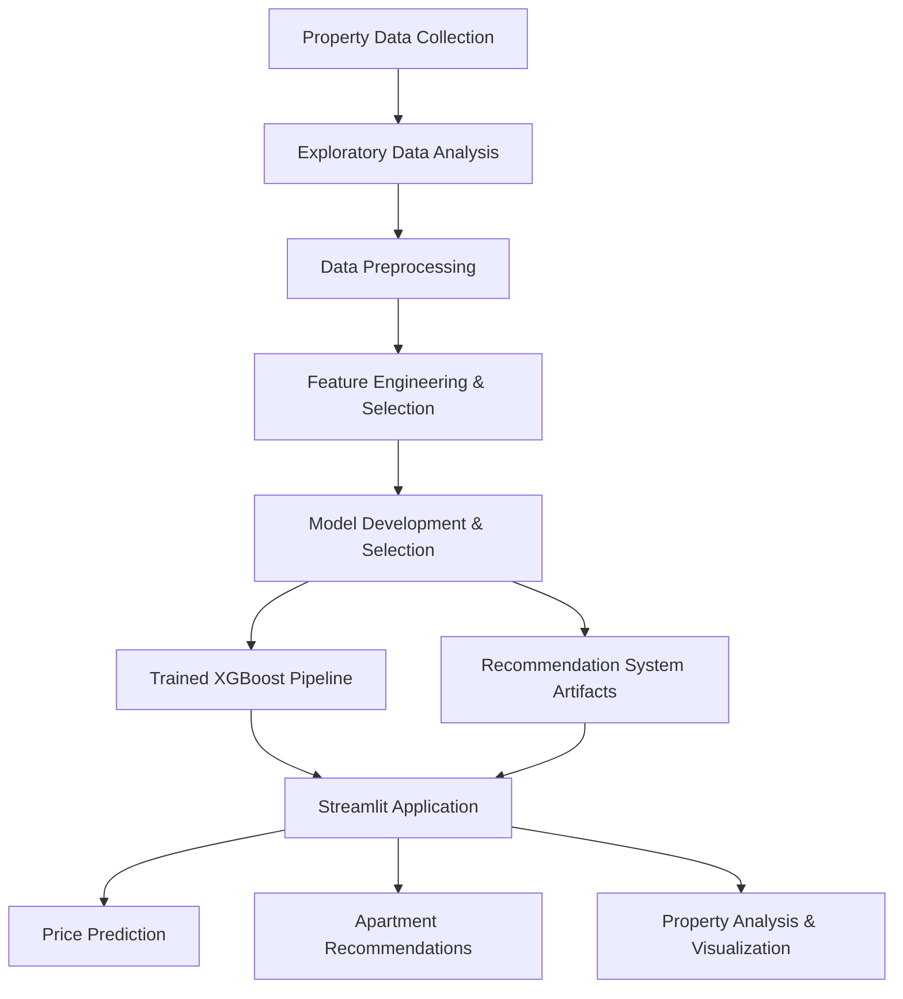

# 🏡 Real Estate Price Prediction & Property Recommendation System


An end-to-end Machine Learning project focused on real estate price prediction and property recommendation. This project covers the ML workflow, from property data collection and exploratory data analysis to feature engineering, model development, and deployment through an interactive Streamlit web application.

---

## 📌 Project Overview

The real estate market involves multiple factors that influence property prices, making property valuation and selection challenging.

This project aims to build a data-driven system that helps users:

- Predict real estate property prices using Machine Learning.
- Explore property-related insights through interactive visualizations.
- Discover and recommend similar apartments using a recommendation system.

The project combines regression-based price prediction and similarity-based property recommendations into a single Streamlit application.

## 🎯 Key Features

### 1. Real Estate Price Prediction
- Data preprocessing and feature engineering.
- Regression model development and selection.
- Trained on multiple models but used the best XGBoost model
- Trained XGBoost pipeline for property price prediction.
- Interactive price prediction interface using Streamlit.

### 2. Apartment Recommendation System
- Similarity-based property recommendations.
- Precomputed similarity matrices.
- Property recommendations based on apartment characteristics.

### 3. Data Analysis and Visualization
- Univariate and multivariate exploratory data analysis.
- Missing-value analysis and treatment.
- Outlier detection and treatment.
- Feature selection and engineering.
- Interactive data analysis through Streamlit.

## 🏗️ Project Architecture

The project follows an end-to-end Machine Learning workflow:



## ⚙️ Machine Learning Workflow

1. **Data Collection:** Collected property data from available datasets and explored web scraping, but faced website access restrictions.
2. **Exploratory Data Analysis:** Understanding data distributions, relationships, patterns and outliers.
3. **Data Preprocessing:** Handling missing values, cleaning data, treating outliers and merging datasets.
4. **Feature Engineering:** Transforming and selecting relevant features for model development.
5. **Model Development:** Experimenting with regression models and selecting a suitable model.
6. **Model Integration:** Saving trained model pipelines and recommendation artifacts.
7. **Deployment:** Integrating the trained artifacts into an interactive Streamlit application.

## 🛠️ Technology Stack

| Category | Technologies |
|---|---|
| Programming Language | Python |
| Data Analysis | Pandas, NumPy |
| Visualization | Matplotlib, Seaborn |
| Machine Learning | Scikit-learn, XGBoost |
| Development | Jupyter Notebook |
| Web Application | Streamlit |
| Model Storage | Pickle |
| Version Control | Git, GitHub |

## 📂 Repository Structure

```text
Real_Estate_ML_Project/
│
├── Real_Estate_Regression_Model/
│   ├── Data/
│   ├── *.ipynb
│   ├── *.csv
│   ├── *.pkl
│   └── requirements.txt
│
├── Streamlit_Application/
│   ├── Home.py
│   ├── pages/
│   │   ├── Analysis.py
│   │   ├── Appartments Recommender.py
│   │   └── Price_Predictor.py
│   ├── datasets/
│   ├── best_xgboost_pipeline.pkl
│   ├── requirements.txt
│   └── lat_long_scrapper.py
│
├── README.md
├── .gitignore
└── requirements.txt
```

## 🚀 Getting Started

### 1. Clone the repository

```bash
git clone https://github.com/YOUR_USERNAME/Real_Estate_ML_Project.git
```

### 2. Navigate to the project directory

```bash
cd Real_Estate_ML_Project
```

### 3. Install dependencies

```bash
pip install -r requirements.txt
```

Alternatively, install the application dependencies:

```bash
pip install -r Streamlit_Application/requirements.txt
```

### 4. Run the Streamlit application

```bash
cd Streamlit_Application
streamlit run Home.py
```

The application will open in your default browser.

## 📊 Application Modules

| Module | Description |
|---|---|
| Price Predictor | Predicts property prices using the trained ML pipeline. |
| Apartments Recommender | Recommends similar apartments using similarity-based artifacts. |
| Analysis | Provides property data analysis and visualizations. |

## 👨‍💻 Project Information

**Project:** Real Estate Price Prediction & Property Recommendation System

**Category:** Machine Learning / End-to-End ML Application

**Project Type:** B.Tech Capstone Project

---

*This project demonstrates the application of Machine Learning techniques to real-world real estate price prediction and property recommendation problems.*
